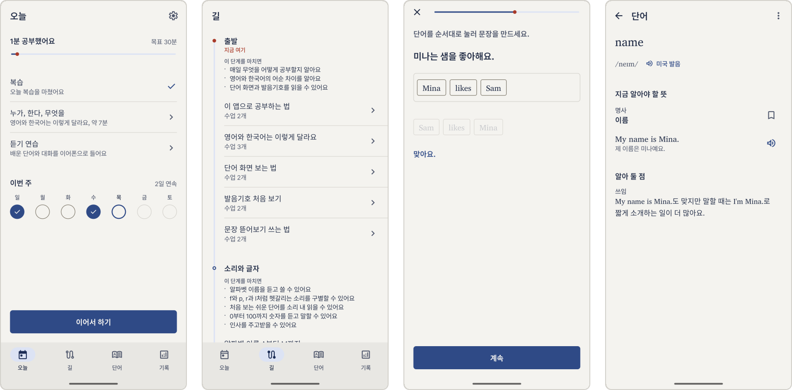

# Gil

[English](README.md)

길(Gil)은 한국어를 쓰는 사람이 알파벳부터 영어를 배우는 Android 앱입니다.
짧은 수업에서 단어와 표현을 몇 개씩 배우고, 잊을 때쯤 복습으로 다시 만납니다.
모든 기능이 휴대폰 안에서 동작합니다. 서버와 계정이 없고, 인터넷 권한도 요청하지 않습니다.



아직 개발 초기 단계이며 출시한 버전은 없습니다.

## 빌드

```
./gradlew :app:installDebug
```

빌드 타입과 풀 리퀘스트 전에 돌릴 검사는 [빌드 문서](docs/build.ko.md)에 있습니다.

## 기여

이슈나 풀 리퀘스트를 열기 전에 [기여 안내](CONTRIBUTING.ko.md)를 읽어 주세요.
코드 구성은 [아키텍처 문서](docs/architecture.ko.md)부터 보면 됩니다.
보안 문제는 [보안 정책](SECURITY.ko.md)에 적힌 방법으로 알려 주세요.

## 라이선스

소스 코드와 학습 내용은 [Apache License 2.0](LICENSE)을 따릅니다.
앱 이름과 아이콘은 이 라이선스에 포함되지 않습니다. 자세한 내용은 [상표 정책](TRADEMARKS.ko.md)에 있습니다.
