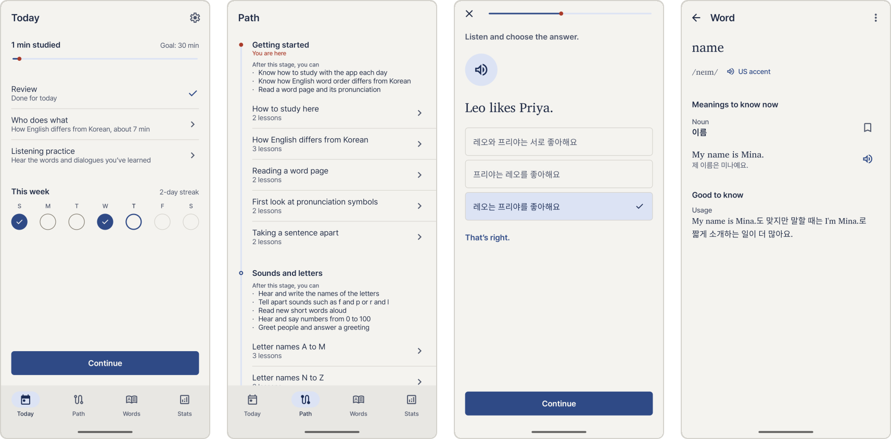

# Gil

[한국어](README.ko.md)

Gil (길, Korean for "path") is an Android app that teaches English to Korean speakers, starting from the alphabet.
Short lessons introduce a few words and phrases at a time, and reviews bring them back before they are forgotten.
It runs entirely on the phone. There is no server or account, and the app does not request the internet permission.



The app is in early development and has no release yet.

## Building

```
./gradlew :app:installDebug
```

Build types and the checks to run before a pull request: [docs/build.md](docs/build.md).

## Contributing

Read [CONTRIBUTING.md](CONTRIBUTING.md) before you open an issue or a pull request.
To see how the code is organized, start with [docs/architecture.md](docs/architecture.md).
To report a security problem, see [SECURITY.md](SECURITY.md).

## License

The source code and the learning content are licensed under the [Apache License 2.0](LICENSE).
The app name and icon are not covered by the license; see [TRADEMARKS.md](TRADEMARKS.md).
