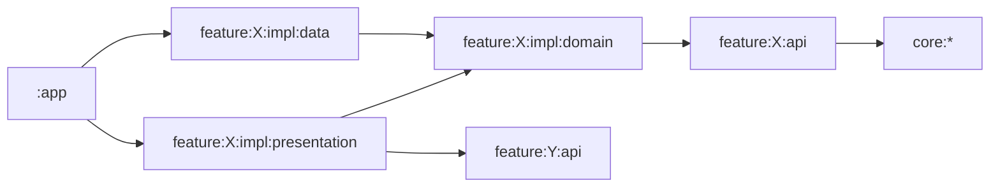

# 아키텍처

[English](architecture.md)

Gil은 기능 모듈 여럿과 core 모듈 몇 개로 이루어진 Android 앱 하나입니다.
모든 것이 폰 안에서 동작합니다. 코스는 빌드할 때 `content/`로 만든 데이터베이스이고, 학습 기록은 기기 안의 데이터베이스와 설정 파일 몇 개에 저장됩니다.

## 모듈

기능 하나는 `feature/<이름>/`에 있고, 필요한 모듈만 둡니다.

- `api`: 다른 기능이 써도 되는 것. 라우트, 공개 모델, `ProgressObserver`·`ProgressCommands` 같은 계약.
- `impl:domain`: 그 기능만의 규칙과, 화면이 쓰는 저장소 인터페이스.
- `impl:data`: 저장소 구현, 대부분의 `api` 계약 구현, 이 둘을 연결하는 Hilt 모듈.
- `impl:presentation`: 화면, ViewModel, 그 기능 라우트의 내비게이션 항목. 다른 기능의 데이터를 읽기만 하는 계약은 여기서 구현하기도 합니다. `ContinueFinder`를 구현한 `TodayContinueFinder`가 그렇습니다.

core 모듈에는 어느 한 기능의 것이 아닌 것을 둡니다. 디자인 시스템(`core:designsystem`), 내비게이터(`core:navigation`), `Outcome`과 공용 오류(`core:domain`), 음성 합성과 녹음(`core:speech`) 같은 것입니다.
`:catalog`는 디자인 시스템 컴포넌트를 모아 보여 주는 개발용 앱이고, `:tools:content-compiler`는 코스 데이터베이스를 만듭니다.

## 의존 규칙

- 다른 기능은 그 기능의 `api` 모듈로만 씁니다. 다른 기능의 `impl` 모듈에 의존하는 모듈은 없습니다.
- `core` 모듈은 기능에 의존하지 않습니다.
- `api`와 `impl:domain`은 Android 의존이 없는 순수 Kotlin 모듈입니다.
- `impl:data`에 의존하는 것은 `:app`뿐입니다. ViewModel은 저장된 데이터를 `impl:domain`의 저장소 인터페이스나 `api`의 계약으로 읽고 씁니다.

빌드가 이 규칙을 검사하지는 않으니, 의존을 더할 때 직접 지켜 주세요.

## 데이터

코스는 `content/`를 컴파일한 SQLite 파일로, 앱 assets에 들어갑니다.
`feature:curriculum:impl:data`가 Room으로 읽고, 다른 기능은 `feature:curriculum:api`의 `CourseObserver`와 `LexiconObserver`로 읽습니다.

학습 기록은 `feature:progress:impl:data`의 Room 데이터베이스입니다. 다른 기능은 `ProgressObserver`로 읽고 `ProgressCommands`로 씁니다.
스키마를 `schemas/`에 커밋하므로, 스키마를 바꾸면 마이그레이션과 `ProgressMigrationTest`의 테스트가 함께 있어야 합니다.

설정 같은 작은 상태는 기능마다 따로 둔 DataStore 파일에 저장합니다. 파일은 `core:datastore`의 `DataStoreFactory`로 `lesson_prefs` 같은 이름을 붙여 만듭니다.
읽을 때는 `dataOrEmpty()`, 쓸 때는 `editCatching {}`을 거칩니다. 그래서 파일을 읽거나 쓰지 못해도 앱이 죽지 않고 기본값이나 `DataError.Local`이 돌아옵니다.

학습일은 현지 시각 새벽 4시에 시작합니다. 그래서 새벽 1시에 한 수업은 전날 저녁 학습으로 셉니다. 기록은 만든 날의 `StudyDay`와 함께 저장하고, 지금의 학습일은 `StudyClock`이 알려 줍니다. 테스트에서는 `FakeStudyClock`으로 바꾸고, 새벽 4시 경계 자체를 시험할 때는 `ZonedStudyClock`을 씁니다.

저장소(repository)는 바뀌는 저장 데이터에는 `Flow`를 돌려주고, 한 번 읽거나 쓰는 일은 `suspend` 함수로 합니다.
ViewModel은 읽은 것을 모아 화면 상태 `StateFlow` 하나로 만듭니다.

## 오류

학습자에게 보일 수 있는 실패는 예외가 아니라 값입니다. `core:domain`의 `Outcome<D, E>`이고, `E`는 `RootError`입니다.
저장소 실패는 `DataError.Local`입니다. `core:database`의 `databaseCall {}`과 `core:datastore`의 `editCatching {}`이 저장소 예외를 이 값으로 바꿉니다.
화면에서 실패를 구분해야 하면 기능이 자기 오류 타입을 둡니다. `feature:curriculum:api`의 `ContentError`가 그 예입니다.
오류를 문구로 바꾸는 일은 presentation 모듈이 합니다. 예를 들어 `core:presentation`의 `DataError.toUiText()`입니다.

## 의존성 주입

Hilt를 쓰고, 그래프는 `:app`에서 닫습니다. `impl:data` 모듈마다 `di/` 패키지가 있고, 그 안의 모듈이 `@Binds`로 구현을 인터페이스에 연결합니다.
ViewModel은 `@HiltViewModel`입니다. 라우트 인자가 필요한 ViewModel은 `LessonViewModel`처럼 assisted injection으로 받습니다.

## 내비게이션

Navigation 3을 씁니다. 기능의 라우트는 그 기능의 `api` 모듈에 `NavKey`를 구현한 `@Serializable` 클래스로 있고, `"lesson.player"` 같은 `@SerialName`을 붙입니다. 라우트에는 ID 같은 작은 값만 담고, 불러온 데이터는 담지 않습니다.

화면이 있는 `impl:presentation` 모듈마다 `lessonEntries(navigator)` 같은 `EntryProviderScope<NavKey>` 확장 함수가 있어서 라우트를 화면에 연결합니다. `:app`이 `MainHost.kt`에서 이 함수들을 부르고, 온보딩 항목은 `OnboardingHost.kt`에서 부릅니다.
다른 기능의 화면을 열 때는 그 기능 `api` 모듈의 라우트를 만들어 `Navigator.goTo`에 넘깁니다.
`Navigator`는 컴포지션에서 만들어 항목 함수에 넘기고, Hilt 그래프에는 넣지 않습니다. 그래서 ViewModel은 직접 화면을 옮기지 않습니다. ViewModel이 이벤트를 보내면 `Root` 컴포저블이 콜백을 부르고, 그 콜백은 `lessonEntries`처럼 항목 함수가 내비게이터에 연결해 둔 것입니다.

메인 화면에는 탭이 네 개 있고, 탭마다 백 스택이 따로 있습니다.
알림, 위젯, 앱 바로가기는 `gil://` 링크로 앱을 엽니다. `:app`의 `GilDeepLinkResolver`가 이 링크를 탭 하나와 그 위에 열 라우트로 바꿉니다.
