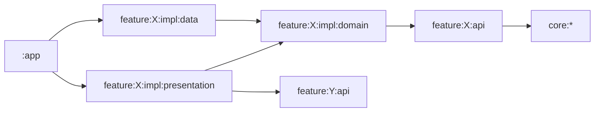

# Architecture

[한국어](architecture.ko.md)

Gil is one Android app made of feature modules and a few core modules.
Everything runs on the phone: the course is a database built from `content/` at build time, and the learner's record is a local database and a few preference files.

## Modules

A feature lives in `feature/<name>/` and has only the modules it needs:

- `api`: what other features may use. Routes, public models, and contracts such as `ProgressObserver` and `ProgressCommands`.
- `impl:domain`: the feature's own rules and the repository interfaces its screens use.
- `impl:data`: the repositories, most implementations of the `api` contracts, and the Hilt module that binds them.
- `impl:presentation`: screens, ViewModels and the navigation entries for the feature's routes. A contract that only reads other features' data can be implemented here, as `TodayContinueFinder` is for `ContinueFinder`.

Core modules hold what no single feature owns, such as the design system (`core:designsystem`), the navigator (`core:navigation`), `Outcome` and the shared errors (`core:domain`), and text-to-speech and recording (`core:speech`).
`:catalog` is a development app that shows the design system's components, and `:tools:content-compiler` builds the course database.

## Dependency rules

- A feature uses another feature only through that feature's `api` module. No module depends on another feature's `impl` modules.
- `core` modules never depend on a feature.
- `api` and `impl:domain` modules are plain Kotlin with no Android dependency.
- Only `:app` depends on `impl:data`. A ViewModel reaches stored data through a repository interface in `impl:domain` or a contract in `api`.

The build does not check these rules, so keep to them when you add a dependency.

## Data

The course is compiled from `content/` into a SQLite file that ships in the app's assets.
`feature:curriculum:impl:data` reads it with Room, and other features read it through `CourseObserver` and `LexiconObserver` in `feature:curriculum:api`.

The learner's record is a Room database in `feature:progress:impl:data`. Other features read it through `ProgressObserver` and write it through `ProgressCommands`.
Its schemas are committed in `schemas/`, so a schema change needs a migration and a test in `ProgressMigrationTest`.

Settings and other small state live in DataStore files, one per feature, each created with `DataStoreFactory` from `core:datastore` under a name such as `lesson_prefs`.
Read them through `dataOrEmpty()` and write them through `editCatching {}`, so a file that cannot be read or written gives defaults or a `DataError.Local` instead of a crash.

A study day starts at 04:00 local time, so a lesson at 1 a.m. counts toward the evening before. Records are stored with the `StudyDay` they were made on, and `StudyClock` gives the current one; tests replace it with `FakeStudyClock`, or with `ZonedStudyClock` where the 04:00 boundary itself is under test.

A repository returns a `Flow` for stored data that changes and uses `suspend` functions for single reads and writes of storage.
A ViewModel combines what it reads into one `StateFlow` of screen state.

## Errors

A failure the learner can see is a value, not an exception: `Outcome<D, E>` in `core:domain`, where `E` is a `RootError`.
Storage failures are `DataError.Local`. `databaseCall {}` in `core:database` and `editCatching {}` in `core:datastore` turn storage exceptions into it.
A feature defines its own error type when a screen needs to tell failures apart, such as `ContentError` in `feature:curriculum:api`.
The presentation module turns an error into text, for example `DataError.toUiText()` in `core:presentation`.

## Dependency injection

Hilt, with the graph closed in `:app`. Each `impl:data` module has a `di/` package whose modules bind implementations to interfaces with `@Binds`.
ViewModels are `@HiltViewModel`. A ViewModel that needs a route argument gets it through assisted injection, as `LessonViewModel` does.

## Navigation

Navigation 3. A feature's routes live in its `api` module as `@Serializable` classes that implement `NavKey`, with a `@SerialName` such as `"lesson.player"`. Routes carry IDs and other small values, never loaded data.

Each `impl:presentation` module with screens has an `EntryProviderScope<NavKey>` extension, such as `lessonEntries(navigator)`, that maps its routes to screens. `:app` calls them in `MainHost.kt`, and the onboarding ones in `OnboardingHost.kt`.
To open another feature's screen, build that feature's route from its `api` module and pass it to `Navigator.goTo`.
The `Navigator` is created in composition and handed to the entry functions; it is not in the Hilt graph, so a ViewModel never navigates. The ViewModel sends an event, and the `Root` composable calls a callback that the entry function connects to the navigator, as `lessonEntries` does.

The main screen has four tabs, each with its own back stack.
Notifications, the widget and the app shortcuts open the app with a `gil://` link, which `GilDeepLinkResolver` in `:app` turns into a tab and the routes to open on it.
